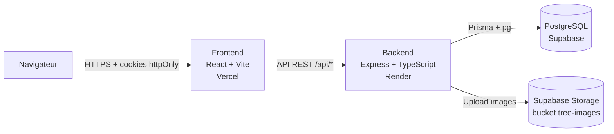
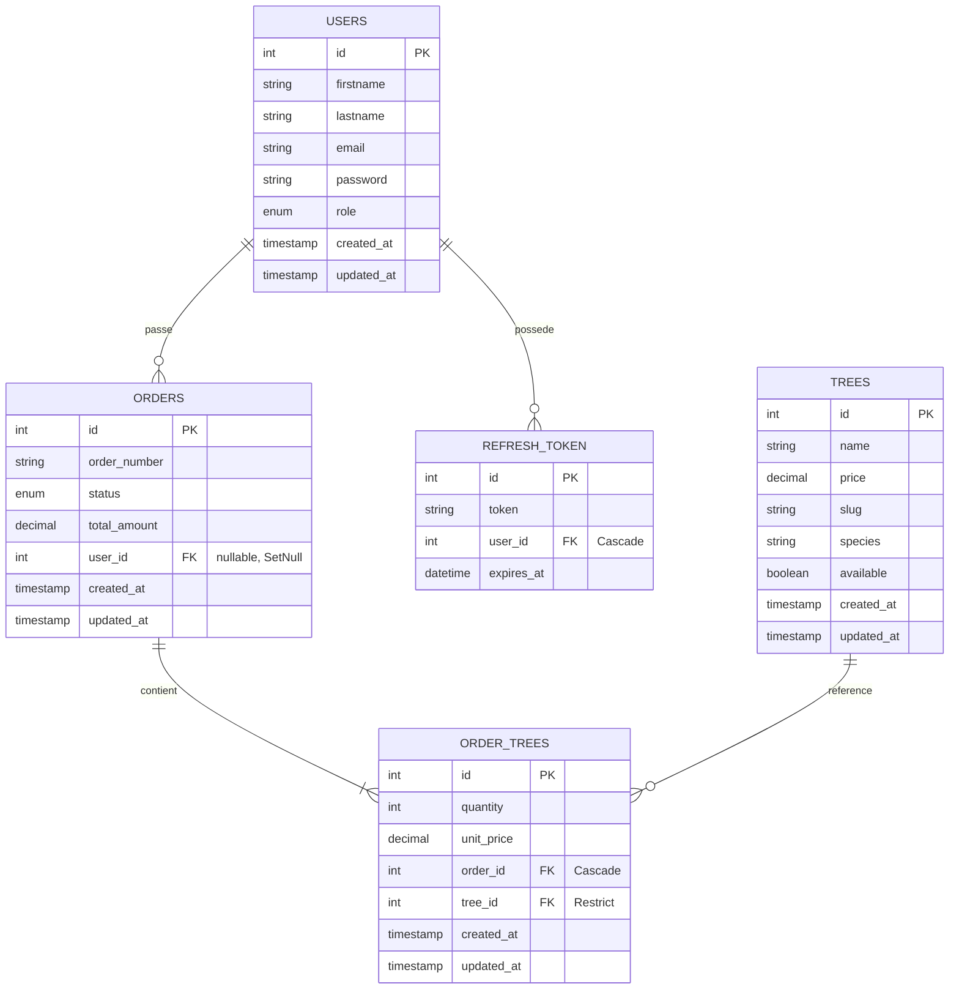

# GreenRoots - API (backend)

> API REST de GreenRoots, plateforme e-commerce de reforestation : le visiteur choisit des arbres, passe commande, et GreenRoots se charge de les planter.

Projet de groupe réalisé dans le cadre du titre professionnel **Concepteur Développeur d'Applications (CDA)** - [O'clock](https://oclock.io), promotion Jakarta.

---

## Sommaire

- [GreenRoots - API (backend)](#greenroots---api-backend)
  - [Sommaire](#sommaire)
  - [1. Contexte et périmètre](#1-contexte-et-périmètre)
    - [Ce que l'API couvre dans le MVP](#ce-que-lapi-couvre-dans-le-mvp)
  - [2. Architecture](#2-architecture)
  - [3. Stack technique](#3-stack-technique)
  - [4. Démarrage rapide](#4-démarrage-rapide)
    - [Prérequis](#prérequis)
    - [Installation](#installation)
    - [Comptes de démonstration (issus du seed)](#comptes-de-démonstration-issus-du-seed)
    - [Scripts](#scripts)
  - [5. Variables d'environnement](#5-variables-denvironnement)
    - [`.env`](#env)
    - [`.env.test`](#envtest)
  - [6. Base de données](#6-base-de-données)
  - [7. API REST](#7-api-rest)
    - [Authentification](#authentification)
    - [Utilisateurs](#utilisateurs)
    - [Arbres](#arbres)
    - [Commandes](#commandes)
    - [Codes de retour usuels](#codes-de-retour-usuels)
  - [8. Authentification et sécurité](#8-authentification-et-sécurité)
  - [9. Données personnelles et RGPD](#9-données-personnelles-et-rgpd)
  - [10. Règles métier](#10-règles-métier)
  - [11. Tests et qualité](#11-tests-et-qualité)
  - [12. Intégration continue](#12-intégration-continue)
  - [13. Déploiement](#13-déploiement)
  - [14. Organisation d'équipe et conventions](#14-organisation-déquipe-et-conventions)
  - [Documentation complémentaire](#documentation-complémentaire)
  - [Équipe](#équipe)


---

## 1. Contexte et périmètre

GreenRoots permet à des particuliers éco-conscients et à des entreprises responsables de financer la plantation d'arbres. Le détail des besoins, personas, contraintes et de l'analyse des risques est dans le **cahier des charges**.

Ce dépôt contient l'**API** : elle expose le catalogue, gère les comptes, les sessions, les commandes et l'upload des images.

### Ce que l'API couvre dans le MVP

| Profil | Fonctionnalités |
|---|---|
| **Visiteur** | Lecture du catalogue et du détail d'un arbre, inscription, connexion |
| **Utilisateur connecté** | Création de commande (paiement virement ou chèque, simulé), historique et détail de ses commandes, modification du profil, suppression du compte |
| **Administrateur** | CRUD des arbres (avec upload d'image), consultation des commandes, validation / annulation d'une commande |


---

## 2. Architecture

Architecture **3 tiers** (présentation, logique métier, données), chaque couche ayant une responsabilité unique. Front et back sont deux dépôts distincts qui communiquent par API REST (JSON).



Organisation du code (`src/`) :

```
routes/        Déclaration des endpoints et des middlewares associés
controllers/   Logique de chaque endpoint
schemas/       Validation des entrées (Zod)
middlewares/   Auth, rôles, rate limiting, gestion d'erreurs, upload
lib/           Client Prisma, client Supabase, gestion des tokens
tests/         Helpers des tests d'intégration
prisma/        schema.prisma, migrations, seed
requests/      Collections REST Client (.http) pour tester l'API à la main
```

---

## 3. Stack technique

| Domaine | Technologies |
|---|---|
| **Serveur** | Node.js (ESM), Express 5, TypeScript, Zod, Argon2, JSON Web Token, express-rate-limit, Multer, cookie-parser, CORS |
| **Base de données** | PostgreSQL, Prisma 7 (adapter `pg`) |
| **Stockage fichiers** | Supabase Storage |
| **Tests** | Vitest (unitaires et intégration) |
| **Qualité** | ESLint, TypeScript (vérification des types via `typecheck`) |
| **Outils d'équipe** | Git / GitHub, Trello, REST Client (VS Code) |
| **Hébergement** | Render (API), Supabase (BDD + images) |

---

## 4. Démarrage rapide

### Prérequis

- Node.js **22.x** (≥ 20.19 requis par Prisma 7) et npm
- Un projet **Supabase** (base PostgreSQL + bucket de stockage), ou un PostgreSQL accessible
- Git

### Installation

```bash
git clone "ssh-github"
cd projet-greenroots-back
npm install
cp .env.example .env            # puis renseigner les valeurs (voir section 5)
npm run db:generate             # génère le client Prisma
npm run db:migrate:deploy       # applique les migrations existantes
npm run db:seed                 # charge les données de démonstration
npm run dev                     # démarre l'API avec rechargement à chaud
```

L'API écoute sur `http://localhost:3000` (variable `PORT`).

> Le client Prisma est généré dans `generated/prisma` (non versionné). Si les imports échouent après un clonage, relancer `npm run db:generate`.

### Comptes de démonstration (issus du seed)

| Rôle | Email | Mot de passe |
|---|---|---|
| Utilisateur | `julien.dupont@example.com` | `User123!` |
| Utilisateur | `sofia.martin@example.com` | `User123!` |

> **Attention**: Ces comptes n'existent que pour la démonstration. Ne jamais lancer le seed sur une base de production.

### Scripts

| Commande | Rôle |
|---|---|
| `npm run dev` | Serveur de développement (`tsx watch`) |
| `npm run build` / `npm start` | Compilation TypeScript / lancement du build |
| `npm run typecheck` | Vérification des types sans compilation |
| `npm run lint` | ESLint |
| `npm run test:unit` | Tests unitaires |
| `npm run test:integration` | Tests d'intégration (base locale dédiée) |
| `npm run db:generate` | Génère le client Prisma |
| `npm run db:seed` | Charge les données de démonstration |
| `npm run db:migrate:dev` | Crée et applique une migration après modification du schéma |
| `npm run db:migrate:deploy` | Applique les migrations existantes (CI / production) |
| `npm run db:migrate:status` | État des migrations |
| `npm run db:reset` | **Attention** Reset complet de la base **+ seed** |
| `npm run db:studio` | Prisma Studio (explorateur de données) |

---

## 5. Variables d'environnement

Le fichier `.env` n'est **jamais versionné** ; seul le `.env.example` l'est.

### `.env`

| Variable | Description |
|---|---|
| `DATABASE_URL` | Chaîne de connexion PostgreSQL (connexion directe Supabase). Encoder en pourcentage les caractères spéciaux du mot de passe |
| `SUPABASE_URL` | URL du projet Supabase |
| `SUPABASE_SERVICE_ROLE_KEY` | Clé service role, **secrète, uniquement côté serveur** |
| `JWT_SECRET` | Secret de signature des access tokens |
| `PORT` | Port d'écoute de l'API |
| `FRONTEND_URL` | Origine autorisée par CORS (ex. `http://localhost:5173`) |
| `NODE_ENV` | `development` ou `production` (influence les options des cookies) |

### `.env.test`

Utilisé uniquement par les tests d'intégration : `DATABASE_URL` (PostgreSQL **local**), `PORT`, `JWT_SECRET`, `ALLOWED_ORIGINS`.

---

## 6. Base de données

PostgreSQL géré via **Prisma** (schéma : `prisma/schema.prisma`, migrations versionnées : `prisma/migrations/`).

| Table | Rôle |
|---|---|
| `users` | Comptes (`role` : `user` / `admin`), mot de passe haché |
| `trees` | Catalogue : nom, espèce, prix, `slug` unique, image, disponibilité |
| `orders` | Commandes : numéro unique, statut (`pending` / `validated` / `cancelled`), montant total |
| `order_trees` | Lignes de commande : quantité et **prix unitaire figé** au moment de l'achat |
| `refresh_token` | Sessions : refresh tokens **hachés**, date d'expiration |



> Généré à partir de `prisma/schema.prisma` (modèle physique). Le MCD/MLD détaillé avec cardinalités et justification des choix reste dans le cahier des charges.

Choix de modélisation à connaître :

- **Montants en `Decimal(10,2)`** : pas d'erreur d'arrondi des flottants.
- **`order_trees.unit_price`** : le prix est copié dans la commande, une modification du catalogue n'altère pas l'historique.
- **`OrderTree → Tree` en `Restrict`** : un arbre déjà commandé ne peut pas être supprimé, on le désactive (`available = false`).
- **`Order → User` en `SetNull`** : la suppression d'un compte conserve les commandes (traçabilité) en les détachant de l'utilisateur.
- **`RefreshToken → User` en `Cascade`** : les sessions disparaissent avec le compte.
- **Panier hors base** : conservé dans le `localStorage` du navigateur, côté front (décision du Sprint 0).
- Tables et colonnes en `snake_case` (sauf `firstname` / `lastname`).

> Toute évolution du schéma passe par `npm run db:migrate:dev`. Un fichier de migration déjà appliqué **ne se modifie jamais** : on en crée un nouveau.

---

## 7. API REST

Préfixe commun : `/api`. Format JSON. L'authentification repose sur des **cookies httpOnly** (le client doit envoyer `credentials: "include"`).

### Authentification

| Méthode | Endpoint | Accès | Description |
|---|---|---|---|
| POST | `/api/auth/register` | Public | Crée un compte |
| POST | `/api/auth/login` | Public | Connexion, pose les cookies `accessToken` et `refreshToken` |
| POST | `/api/auth/refresh` | Cookie refresh | Renouvelle la paire de tokens, renvoie l'utilisateur |
| POST | `/api/auth/logout` | Public | Déconnexion |

### Utilisateurs

| Méthode | Endpoint | Accès | Description |
|---|---|---|---|
| PATCH | `/api/users/me/profile` | Connecté | Modifie prénom, nom, email (au moins un champ) |
| DELETE | `/api/users/me` | Connecté | Supprime le compte (mot de passe requis dans le body) |

### Arbres

| Méthode | Endpoint | Accès | Description |
|---|---|---|---|
| GET | `/api/trees` | Public | Liste du catalogue |
| GET | `/api/trees/:slug` | Public | Détail d'un arbre |
| POST | `/api/trees` | Admin | Crée un arbre (`multipart/form-data`, champ `image`) |
| PATCH | `/api/trees/:slug` | Admin | Modifie un arbre (image optionnelle) |
| DELETE | `/api/trees/:slug` | Admin | Supprime un arbre |

Images acceptées : JPEG, PNG, WebP, **5 Mo maximum**.

### Commandes

| Méthode | Endpoint | Accès | Description |
|---|---|---|---|
| POST | `/api/orders` | Connecté | Crée une commande depuis le panier : `{ "items": [{ "treeId": 1, "quantity": 2 }] }` |
| GET | `/api/orders` | Connecté | Historique de ses commandes |
| GET | `/api/orders/:id` | Connecté | Détail d'une de ses commandes |
| GET | `/api/admin/orders` | Admin | Toutes les commandes |
| PATCH | `/api/admin/orders/:id/status` | Admin | Passe une commande en `validated` ou `cancelled` |

### Codes de retour usuels

`400` données invalides · `401` non authentifié · `403` rôle insuffisant · `404` ressource introuvable · `409` conflit (email existant, commande en attente) · `422` arbre indisponible · `429` trop de requêtes.

Des collections prêtes à l'emploi pour l'extension **REST Client** sont fournies dans `requests/`.

---

## 8. Authentification et sécurité

**Flux d'authentification**

1. `login` vérifie le mot de passe (Argon2) puis pose deux cookies `httpOnly` :
   - `accessToken` : JWT signé, **15 minutes** ;
   - `refreshToken` : valeur aléatoire de 128 octets, **7 jours**, stockée en base sous forme de **hash SHA-256**.
2. Quand l'access token expire, l'API répond `401` ; le front appelle alors `/api/auth/refresh` puis rejoue la requête.
3. À chaque refresh, le refresh token est **renouvelé** (rotation) ; une seule session active par utilisateur.

**Mesures en place**

| Risque | Mesure |
|---|---|
| Vol de mots de passe | Hachage Argon2 ; politique : 8 caractères minimum, une majuscule, un chiffre |
| Vol de session (XSS) | Tokens en cookies `httpOnly`, jamais accessibles au JavaScript ; `secure` + `sameSite=none` en production |
| Vol du refresh token en base | Stocké haché, jamais en clair |
| Injection / données invalides | Validation Zod de toutes les entrées ; requêtes paramétrées via Prisma |
| Accès non autorisé | Middlewares `verifyAuth` puis `verifyAdmin`, contrôle du rôle **côté serveur** |
| Force brute | Rate limiting : login 3 échecs / 15 min, inscription 4 / h, refresh 30 / 15 min, suppression de compte 3 échecs / 15 min |
| Upload malveillant | Filtre sur le type MIME déclaré, taille limitée, stockage en mémoire |
| Fuite de secrets | `.env` ignoré par Git, `.env.example` fourni, clé Supabase uniquement côté serveur |
| Origine non autorisée | CORS restreint à `FRONTEND_URL`, avec credentials |


---

## 9. Données personnelles et RGPD

Le traitement des données personnelles est décrit aux visiteurs dans la page **Politique de confidentialité** du front (`/privacy-policy`). Voici le lien entre ce texte et son implémentation côté API :

| Principe RGPD | Mise en œuvre technique |
|---|---|
| Minimisation des données | Seuls prénom, nom et e-mail sont demandés à l'inscription ; aucune donnée bancaire n'est collectée (paiement simulé, virement ou chèque) |
| Sécurité des données | Mot de passe haché (Argon2, jamais stocké en clair), refresh token haché en base (SHA-256), cookies `httpOnly` |
| Droit à l'effacement | `DELETE /api/users/me` : suppression du compte après vérification du mot de passe |
| Conservation proportionnée |À la suppression du compte, les commandes en attente sont annulées et le compte est supprimé dans une transaction ; les commandes déjà traitées sont conservées sans lien avec cet utilisateur (`user_id` mis à :`null`, relation SetNull), pour la traçabilité comptable et le suivi des plantations|
| Sécurité des accès | Accès aux données de gestion (catalogue, commandes) réservé aux comptes `admin`, contrôlé côté serveur |

---

## 10. Règles métier

- **Une seule commande `pending` par utilisateur.** Une seconde création renvoie un `409` avec le détail de la commande en attente, que le front propose de reprendre.
- Une commande ne contient un arbre qu'**une seule fois** ; les arbres inexistants (`404`) ou indisponibles (`422`) sont refusés.
- Le **paiement est simulé** : l'administrateur fait passer la commande de `pending` à `validated` ou `cancelled`.
- Les commandes `pending` depuis **30 jours ou plus** sont annulées automatiquement lors de la consultation admin. Choix de simplicité pour le MVP ;
- **Suppression de compte** : mot de passe exigé ; les commandes en attente sont annulées, les commandes existantes sont conservées (détachées de l'utilisateur), le tout dans une **transaction**.

---

## 11. Tests et qualité

```bash
npm run test:unit          # Tests unitaires (schémas Zod, tokens, utilitaires)
npm run test:integration   # Tests d'intégration sur l'API réelle
npm run lint
npm run typecheck
```

**Périmètre actuel** : 25 tests répartis sur 8 fichiers.

| Fichier | Type | Ce qui est vérifié |
|---|---|---|
| `auth.schema.unit.test.ts` | Unitaire | Validation des schémas Zod d'authentification |
| `user.schema.unit.test.ts` | Unitaire | Validation des schémas Zod utilisateur |
| `tree.schema.unit.test.ts` | Unitaire | Validation des schémas Zod arbre |
| `admin-order.schema.unit.test.ts` | Unitaire | Validation des schémas Zod commande (admin) |
| `token.unit.test.ts` | Unitaire | Génération / vérification des tokens |
| `tree.controller.unit.test.ts` | Unitaire | Logique du contrôleur arbre |
| `auth.integration.test.ts` | Intégration | Flux d'authentification sur l'API réelle |
| `tree.controller.integration.test.ts` | Intégration | Endpoints arbre sur l'API réelle |

Les **tests d'intégration** démarrent l'application sur un port dédié et interrogent une vraie base. Par sécurité, la configuration **refuse de s'exécuter** si la base n'est pas une PostgreSQL **locale** nommée `greenroots_test` (port 5432) : impossible de toucher par erreur la base Supabase.

Mise en place :

1. Créer la base locale : `createdb greenroots_test`
2. Copier `.env.test.example` vers `.env.test` et ajuster `DATABASE_URL`
3. Appliquer les migrations sur cette base :
   ```bash
   DATABASE_URL="postgresql://<user>:<password>@localhost:5432/greenroots_test" npm run db:migrate:deploy
   ```
4. Lancer `npm run test:integration`


---

## 12. Intégration continue

Il n'y a pas, à ce stade, de pipeline CI automatisé (pas de workflow GitHub Actions). La qualité est garantie **manuellement, avant chaque merge** :

1. Le contributeur lance en local `npm run lint`, `npm run typecheck` et `npm run test:unit`
2. La Pull Request est ouverte vers `develop` et passe par une **revue de code obligatoire** (voir [Organisation d'équipe](#14-organisation-déquipe-et-conventions))
3. Le merge n'est validé qu'après retour positif du relecteur

---

## 13. Déploiement

| Composant | Hébergeur | URL | Notes |
|---|---|---|---|
| API | Render | `https://greenroots-back-pf0p.onrender.com/` | Toutes les variables de la section 5 ; build `npm run build`, démarrage `npm start` |
| Base de données et images | Supabase | - | Migrations via `npm run db:migrate:deploy` ; bucket **`tree-images`** à créer (accès public en lecture pour l'affichage des visuels) |

Points d'attention en production :

- `NODE_ENV=production` est **indispensable** : il active `secure` et `sameSite=none` sur les cookies, nécessaires car front et back sont sur des domaines différents.
- `FRONTEND_URL` doit correspondre exactement à l'origine du front déployé.

---

## 14. Organisation d'équipe et conventions

Projet mené en **méthode agile (Scrum)**, en sprints : conception (Sprint 0), développement, déploiement et recettage. Daily quotidien, tableau Trello tenu à jour, revue de code obligatoire avant chaque merge.

| Membre | Rôle Scrum | Référent technique |
|---|---|---|
| Maxime | Product Owner | Frontend |
| Selim | Lead Dev | Backend |
| Charbel | Scrum Master | Base de données |

Répartition du travail **par fonctionnalité** (chaque membre intervient sur toutes les couches), les référents garantissant la cohérence de leur domaine.

**Git**

```
main      ← production
  ↑
develop   ← intégration
  ↑
feature/… ← une branche par fonctionnalité
```

Intégration dans `develop` par **Pull Request** avec revue. Commits atomiques suivant la convention.

**Code**

- Code et identifiants en **anglais**
- `camelCase` pour variables et fonctions, `PascalCase` pour types
- Routes API en `kebab-case`, tables et colonnes SQL en `snake_case`
- Exports nommés privilégiés
- Validation systématique des entrées avec Zod
- ESLint et `typecheck` au vert avant toute PR

---


## Documentation complémentaire

- **Cahier des charges** : besoins, personas, user stories, analyse des risques, MCD / MLD
- **README du frontend** : routes, accessibilité, gestion du panier

## Équipe

Maxime, Selim et Charbel - formation CDA O'clock, promotion Jakarta.
